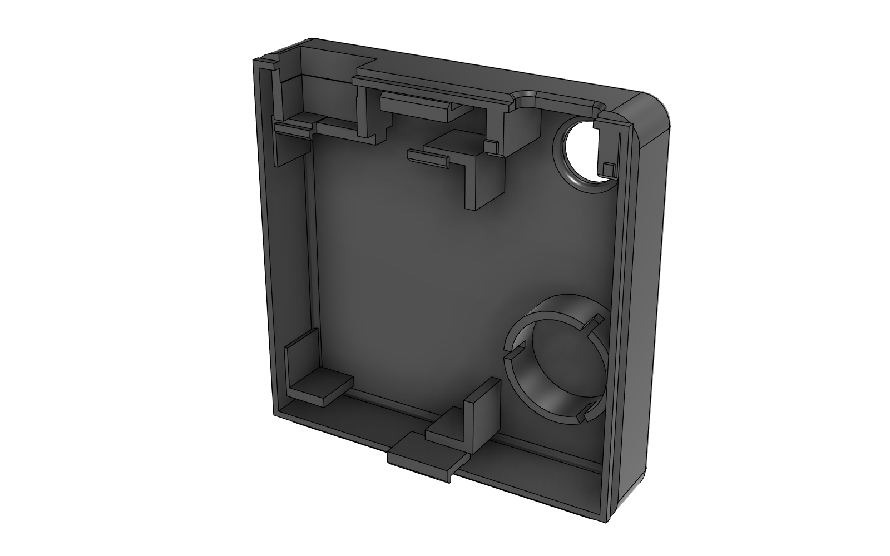
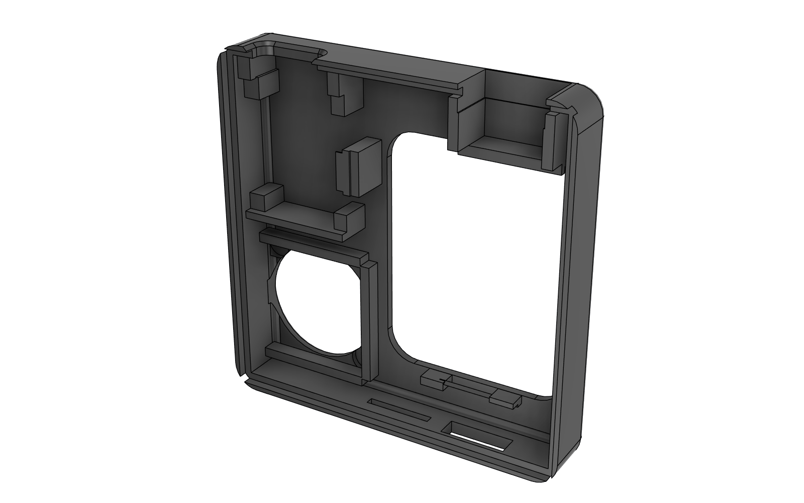

# 3D Printing Files — MIphoto Enclosure Release
### Production Ready FDM CAD Models (Bambu Lab AMS / Prusa / Voron)

This directory contains the production-ready 3D CAD assets exported directly from Autodesk Fusion 360 (`Obudowa.f3d`) for FDM 3D printing.

  
  

---

## 1. File Inventory / Wykaz Plików

| File Name | Format | Description / Application |
| :--- | :---: | :--- |
| `PART_Shell_Rear_V8.stl` | STL (High Mesh) | Rear shell: 1.69" IPS window, continuous solid joystick cradle walls (no screw through-holes), external power switch aperture, and shutter cradle. |
| `PART_Shell_Rear_V8.step` | STEP AP214 | Parametric B-Rep STEP solid of the rear enclosure shell. |
| `PART_Shell_Front_V8.step` | STEP AP214 | **Master multi-material file for Bambu Studio / OrcaSlicer AMS** (front shell + 5 embossed MiCam logo bodies). |
| `PART_Shell_Front_V8_Body.stl` | STL (High Mesh) | Single-color front shell. |
| `Shutter_Plunger_Button.stl` | STL (High Mesh) | Mechanical tactile shutter button plunger ($12.0\text{ mm} \times 12.0\text{ mm}$ cap, $0.65\text{ mm}$ travel, $+0.40\text{ mm}$ clearance). |
| `front_multicolor_stl/` | Folder STL | Individual STL solid bodies for multi-color slicers (`Body_Shell_Front.stl`, `Logo_M_top.stl`, etc.). |

---

## 2. Recommended Slicing Parameters (Bambu Studio / OrcaSlicer)

* **Filament Material:** **PETG** (Bambu PETG Basic / HF or Prusament PETG) for compliant snap-fit durability and thermal stability.
* **Build Plate:** **Textured PEI Plate** (provides a premium matte textured finish on front and rear exterior faces).
* **Print Bed Orientation:**
  * `PART_Shell_Front`: Face down ($Z = +11.0\text{ mm}$ face flat on PEI build plate).
  * `PART_Shell_Rear`: Face down ($Z = -10.0\text{ mm}$ face flat on PEI build plate).
* **Layer Height:** **$0.16\text{ mm}$ Optimal** (first layer: $0.20\text{ mm}$).
* **Wall Loops:** **4 perimeters** (Wall Generator: **Arachne**).
* **Infill:** **$20\%$ Gyroid**.
* **Support:** **None required** (all overhangs chamfered $\le 45^\circ$, bridges optimized for standard FDM).

---

## 3. Multicolor Logo Printing Guide (Bambu Lab AMS)

1. Drag and drop `PART_Shell_Front_V8.step` into Bambu Studio / OrcaSlicer.
2. When prompted: *"The file contains multiple parts. Load them as a single object with multiple parts?"*, click **YES**.
3. In the left object hierarchy, assign filaments:
   * `Body_Shell_Front` $\to$ Filament 1 (e.g. Matte Black PETG).
   * All `Logo_*` parts $\to$ Filament 2 (e.g. Traffic Orange or White PETG).
4. Because the logo geometry is exactly $0.40\text{ mm}$ deep (first 2 layers on the bed), only **2 filament swaps** occur during the entire print, generating minimal purge waste.
