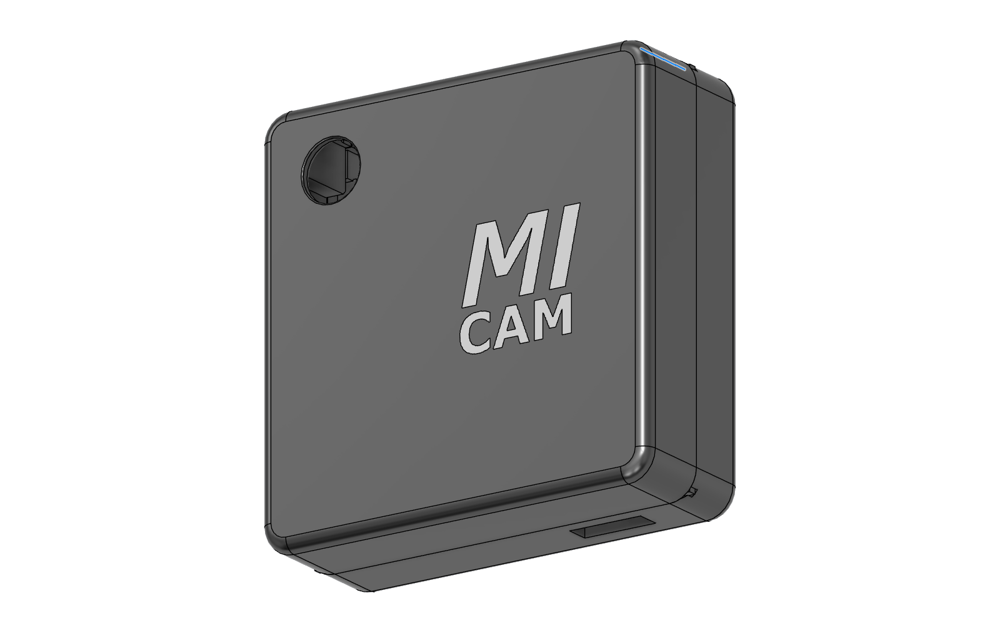
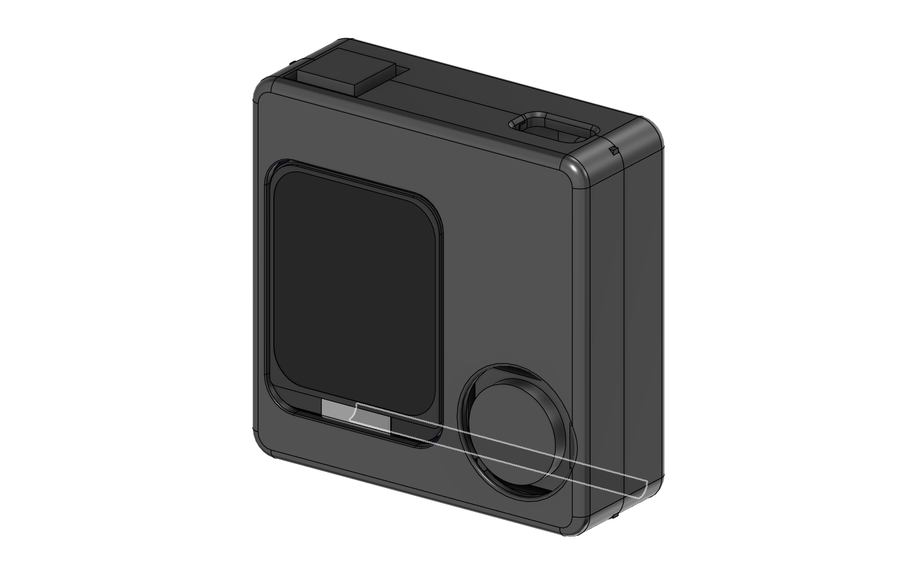
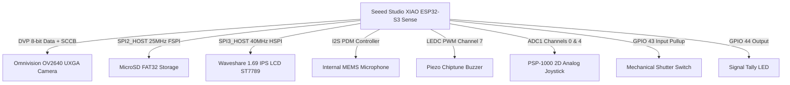

# MIphoto
### Open-Source Ultra-Compact Retro Digital Camera (ESP32-S3 Sense + Parametric CAD)

[](https://platformio.org/)
[](https://www.espressif.com/)
[](https://www.ovt.com/)
[](https://www.waveshare.com/)
[](https://www.autodesk.com/products/fusion-360)

<p align="center">
  
  
</p>

**MIphoto** is a modular, high-performance open-source retro digital camera engineered around the **Seeed Studio XIAO ESP32-S3 Sense** (ESP32-S3R8 with 8MB Octal OPI PSRAM, 8MB Flash). It combines a custom 3D-printed enclosure designed in Autodesk Fusion 360 with production-grade, 100% non-blocking C++ firmware.

---

## 1. System Architecture & Pinout Separation

To guarantee deterministic framerates, zero audio dropouts, and prevent SPI DMA collisions, all buses are strictly isolated at the hardware level:



### Complete Hardware Pinout Map

| Subsystem | Bus / Protocol | ESP32-S3 GPIO | Physical Pin | Engineering Notes |
| :--- | :--- | :--- | :--- | :--- |
| **DVP Camera Data** | DVP 8-bit Parallel | GPIO 15, 17, 18, 16, 14, **12**, 11, 48 | Sense B2B | D5 on Sense board maps to **GPIO 12** (no conflict with SD CS). |
| **DVP Camera Control**| SCCB / Clock Lines | XCLK: 10, PCLK: 13, VSYNC: 38, HREF: 47, SDA: 40, SCL: 39 | Sense B2B | 20 MHz XCLK generated via LEDC timer. |
| **MicroSD Card** | SPI2 (FSPI) | **CS: 21**, SCK: 7, MISO: 8, MOSI: 9 | Sense B2B / D8-D10 | 25 MHz FAT32 write operations with custom EXIF injection. |
| **Digital PDM Mic** | I2S PDM RX | **DATA: 41**, **CLK: 42** | Internal B2B | Dedicated internal lines; zero conflict with external headers. |
| **ST7789 IPS Display**| SPI3 (HSPI) | SCLK: D1 (2), MOSI: D2 (3), DC: D3 (4) | D1, D2, D3 | 40 MHz SPI via LovyanGFX. Screen CS wired to GND; RST to 3.3V. |
| **2D Analog Joystick**| Dual ADC1 | **X-Axis: D0 (GPIO 1)**, **Y-Axis: D4 (GPIO 5)** | D0, D4 | Dedicated hardware ADC channels for directional navigation. |
| **Shutter Button** | Digital GPIO | **D6 (GPIO 43)** | D6 | Tactile button with non-blocking 30 ms debounce & long-press. |
| **Tally LED** | Digital Output | **D7 (GPIO 44)** | D7 | Visual shutter countdown and photo save confirmation. |
| **Piezo Buzzer** | LEDC PWM | **D5 (GPIO 6)** | D5 | 8-bit non-blocking chiptune tone generator (Channel 7). |

---

## 2. Firmware Highlights

* **Zero-Leak Memory Architecture:** Framebuffers are pre-allocated in 8MB Octal PSRAM at startup (`FRAMESIZE_UXGA`). Dynamic switching between 240x240 RGB565 Live View and UXGA JPEG capture occurs without DMA pool reallocations.
* **Non-Blocking State Machine:** 100% cooperative multitasking loop based on `millis()`. Zero blocking `delay()` calls in the main loop.
* **LovyanGFX Display Engine:** Dedicated 40 MHz SPI DMA driver for ST7789. On 240x280 panels, the 240x240 camera viewfinder is preserved 1:1, leaving a dedicated 40px bottom telemetry HUD bar (photo counter, preset badge, SD status).
* **Direct Hardware ISP Tuning:** Real-time register control of Omnivision OV2640 DSP for 6 photographic presets:
  1. `AUTO ISP`: Lens shading correction, black/hot pixel removal, nonlinear raw gamma, and AEC2 matrix exposure.
  2. `BRIGHT DAY`: Highlight clipping protection, low ISO gain ceiling (2x), vivid saturation (+2), crisp hardware edge enhancement.
  3. `NIGHT`: Extended exposure time, AEC2 disabled for maximum integration, 64x gain ceiling, noise sharpening suppression.
  4. `MACRO / PORTRAIT`: Softened edge ringing, warm white balance, +1 shadow lift.
  5. `RETRO Y2K`: Early 2000s digicam look with natural corner vignetting, vintage gamma curve, and organic sensor noise.
  6. `LOMOGRAPHY CROSS`: Strong vignette, saturated color shifts, cross-processed aesthetic.
* **Acoustic Clap Shutter:** Real-time digital 1-pole high-pass filter running on I2S PDM samples, filtering ambient rumble (< 250 Hz) and triggering a 2-second rhythmic countdown upon detecting a sharp clap impulse.
* **Chiptune Piezo Audio:** Asynchronous note sequencer playing retro audio cues: Nintendo Wii Mii Channel melody, iconic "Mii-ii!" greeting, and mechanical shutter clicks.
* **SoftAP Web Control Console & Captive Portal:** Built-in Wi-Fi access point (`MIphoto-cam`) with mDNS (`http://miphoto.local`) and Captive Portal DNS redirection. Provides live mobile streaming, remote shutter trigger, acoustic VU meter calibration, and full gallery file downloads.

---

## 3. Repository Structure

```plaintext
MIphoto/
├── 3d_print_files/             # Production-ready 3D print assets (STEP & STL)
│   ├── PART_Shell_Front_V8.step# Multicolor front shell (Bambu AMS)
│   ├── PART_Shell_Rear_V8.step # Rear shell with LCD, switch & joystick mounts
│   ├── Shutter_Plunger_Button.stl # Tactile button plunger
│   └── README.md               # Slicing guidelines and filament configuration
├── cad_models/                 # Manufacturer COTS STEP models & hardware assembly guide
│   ├── Seeed_Studio_XIAO_ESP32S3_Sense.step
│   ├── Waveshare_1.69_LCD_Module.step
│   └── README.md               # Hardware specifications, pinout & assembly manual
├── include/
│   ├── audio_mic.h             # Digital I2S PDM microphone and clap detection
│   ├── buzzer.h                # Non-blocking chiptune audio synthesizer
│   ├── camera_driver.h         # Omnivision OV2640 DVP driver & ISP presets
│   ├── config.h                # Pinout definitions, bus frequencies, and FSM enums
│   ├── display_ui.h            # LovyanGFX ST7789 display driver & retro UI
│   ├── sd_storage.h            # MicroSD FAT32 file storage & EXIF metadata injector
│   └── wifi_share.h            # SoftAP WebServer & mobile control console
├── src/
│   ├── audio_mic.cpp
│   ├── buzzer.cpp
│   ├── camera_driver.cpp
│   ├── display_ui.cpp
│   ├── main.cpp                # Core application entry & FSM dispatcher
│   ├── sd_storage.cpp
│   └── wifi_share.cpp
├── platformio.ini              # Build environment configuration (ESP32-S3 Octal PSRAM)
└── README.md                   # Project overview & documentation
```

---

## 4. 3D Enclosure & DFM Engineering

The camera enclosure is modeled in **Autodesk Fusion 360** (`Obudowa.f3d`) adhering strictly to FDM 3D printing design standards (Design for Manufacturability). Both shell halves feature dedicated internal mounting cradles, eliminating loose fasteners and allowing clean tool-free snap assembly:

<p align="center">
  
  
</p>

### Enclosure Architecture & Mechanical Features:
* **Form Factor & Ergonomics:** External envelope of $80.0\text{ mm} \times 58.0\text{ mm} \times 21.0\text{ mm}$ featuring continuous $2.0\text{ mm}$ perimeter fillets for a smooth, tactile handheld feel reminiscent of classic compact rangefinders.
* **Front Shell Interior Features:**
  - **Camera Lens Collar:** Light-tight cylindrical shroud ($11.0\text{ mm}$ inner diameter) protecting the OV2640 sensor from internal stray light with bottom ribbon cable relief notch.
  - **Tally LED Channel:** $3.2\text{ mm}$ blind optical guide channel for 3mm diffuse indicator LED.
  - **USB-C Port Guide & Ribbing:** Perimeter port cutout for direct USB-C flashing and LiPo charging without opening the enclosure.
  - **Front Shutter Switch Support:** Front half of the $12.80 \times 12.80\text{ mm}$ plunger aperture and solid horizontal support shelf ($1.60\text{ mm}$ thick) backing the tactile switch.
* **Rear Shell Interior Features:**
  - **Continuous Solid Joystick Cradle:** Continuous surrounding cradle walls securely seat the PSP-1000 analog joystick with $1.4\text{ mm}$ internal blind relief pockets for diagonal mounting ears. The bottom shell floor remains 100% solid on the exterior (zero through-holes), allowing clean hot-glue bonding and custom manual trimming.
  - **External Power Switch Insertion:** Precision $10.60 \times 3.40\text{ mm}$ aperture through the bottom wall allows inserting the SS12D00 slide switch from the outside, keeping the toggle fully exposed while providing internal wiring relief for hot-glue potting.
  - **1.69" IPS LCD Retention:** Dual compliant snap hooks with $45^\circ$ lead-in ramps and bottom resting ledges secure the display board without requiring M2 screws.
  - **Snug Xiao Board Fit:** Lateral positioning ribs restrict horizontal play to $+0.37\text{ mm}$, while front corner clamp steps eliminate vertical tilt while keeping the MicroSD slot easily accessible.
  - **Rear Shutter Switch Support:** Symmetrical $1.60\text{ mm}$ rigid support shelf preventing the tactile switch from sinking inward under hard presses while providing a $4.0\text{ mm}$ central wire clearance slot.
* **Tactile Shutter & $12\times 12\text{ mm}$ Cap Clearance:** Precision $12.80\text{ mm} \times 12.80\text{ mm}$ top aperture allows standard $12.0\text{ mm}$ plunger caps to travel with $+0.40\text{ mm}$ sliding clearance without binding.
* **Tool-Free Snap-Fit Enclosure:** Perimeter cantilever snaps with $30^\circ$ lead-in ramps and a continuous tongue-and-groove joint ensure light-tight sealing and easy maintenance.
* **Multicolor Branding (AMS Ready):** Master STEP file includes embossed "MiCam" logo bodies for 2-swap AMS printing with near-zero purge waste.

---

## 5. Building and Uploading

### Prerequisites
* [PlatformIO IDE](https://platformio.org/) (VSCode extension or PlatformIO Core CLI).

### CLI Build & Upload Commands

```powershell
# 1. Compile firmware
& "$env:USERPROFILE\.platformio\penv\Scripts\platformio.exe" run

# 2. Upload to ESP32-S3
& "$env:USERPROFILE\.platformio\penv\Scripts\platformio.exe" run -t upload

# 3. Open Serial Monitor (115200 baud)
& "$env:USERPROFILE\.platformio\penv\Scripts\platformio.exe" device monitor -b 115200

# 4. All-in-one Build, Upload, and Monitor
& "$env:USERPROFILE\.platformio\penv\Scripts\platformio.exe" run -t upload -t monitor
```

### Out-of-the-Box Headless Wi-Fi Testing Mode
If testing without the LCD or buttons soldered, the camera automatically launches SoftAP mode on boot:
1. Connect mobile phone to Wi-Fi SSID: **`MIphoto-cam`** (Open network, no password).
2. Open browser and navigate to: **`http://miphoto.local`** (or `http://192.168.4.1`).
3. Experience live viewport streaming, remote UXGA capture, mic calibration, and photo downloads.

### ESP32-S3 ROM Bootloader Procedure
If the serial port does not respond (e.g. after a hard crash):
1. Press and hold the miniature **`B` (BOOT)** button on the XIAO board.
2. Short-press and release the **`R` (RESET)** button.
3. Release the **`B`** button.
4. The system will detect `ESP32-S3 ROM Bootloader` on USB CDC. Run `pio run -t upload`. Once flashing completes, press **`R`** once to reboot into normal execution.

---

## License & Attribution

Designed and engineered for open-source embedded development. Built with Seeed Studio XIAO ESP32-S3 Sense, LovyanGFX, and Autodesk Fusion 360.
