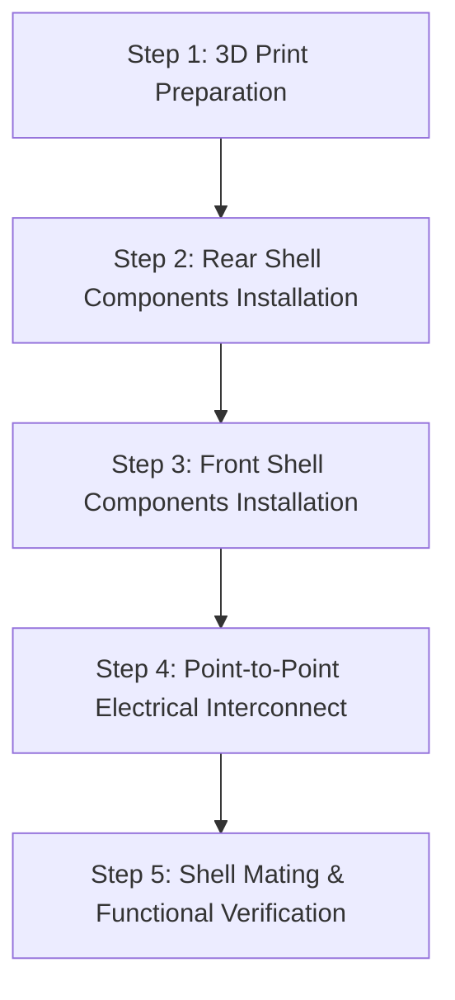

# CAD Models & Hardware Assembly Guide — MIphoto
### Parametric CAD Architecture, Manufacturer STEP References & Step-by-Step Assembly Manual

This directory contains the official manufacturer COTS (Commercial Off-The-Shelf) 3D CAD models integrated into the Autodesk Fusion 360 parametric design (`Obudowa.f3d`), along with the complete mechanical specifications and physical assembly guide for the **MIphoto** camera.

---

## 1. Manufacturer COTS STEP Models Inventory

To eliminate geometric guesswork and bounding-box errors, exact 3D models were acquired directly from manufacturer documentation and integrated into the primary CAD assembly:

| Component | Model / STEP File | Source / Documentation | Description & Embedded Geometry |
| :--- | :--- | :--- | :--- |
| **SoC + Camera + SD Module** | [`Seeed_Studio_XIAO_ESP32S3_Sense.step`](./Seeed_Studio_XIAO_ESP32S3_Sense.step) | Official Seeed Studio Wiki CDN | Complete geometry: XIAO S3 mainboard, USB-C receptacle, Boot/Reset tact switches, high-density B2B connector, Sense expansion PCB with MicroSD slot, OV2640 camera sensor with lens barrel, and internal PDM MEMS microphone. |
| **1.69" IPS Display Module** | [`Waveshare_1.69_LCD_Module.step`](./Waveshare_1.69_LCD_Module.step) | Official Waveshare Wiki | PCBA substrate ($31.52 \times 39.02\text{ mm}$), IPS panel with 2.5D curved protective glass ($R=4.8\text{ mm}$ rounded corners), FPC ribbon cable, and 4x M2 mounting stud baselines ($24.30 \times 31.80\text{ mm}$ pitch). |
| **Rechargeable LiPo Battery** | Akyga LP503040 / 503040 | Standard 1S 3.7V 550mAh | Prismatic lithium-polymer pouch ($30.0 \times 40.5 \times 5.0\text{ mm}$) with integrated PCM protection board. |
| **Thumb Slide Analog Joystick** | PSP-1000 / SparkFun COM-09426 | COTS 2D Potentiometer | Low-profile slide joystick ($19.0 \times 19.0 \times 9.5\text{ mm}$ base, $\varnothing 16.5\text{ mm}$ collar) with dual mounting tabs. |
| **Miniature Power Switch** | SS12D00 Slide Switch | COTS 1P2T Micro Switch | Body dimensions: $10.0 \times 2.6 \times 3.5\text{ mm}$; switch toggle height: $4.0\text{ mm}$. |

---

## 2. Spatial Architecture & Zero-Collision Engineering

The camera body is engineered as a high-density, two-piece clamshell enclosure ($80.0\text{ mm} \times 58.0\text{ mm} \times 21.0\text{ mm}$) split along a continuous $Z = 0.0\text{ mm}$ parting line. Internal components are layered across the Z-axis to eliminate physical interference:

```
◄────────────────────────────── 80.0 mm ──────────────────────────────►
┌──────────────────────────────────────┬──────────────────────────────┐ ▲
│  XIAO ESP32-S3 Sense + OV2640 Lens   │  Tactile Shutter Switch      │ │
│  (Top-Left Corner, Front Shell)      │  (Top-Right Corner, Z-split) │ │
├──────────────────────────────────────┼──────────────────────────────┤ 58.0 mm
│  1.69" IPS Display ST7789            │  550mAh LiPo Battery Pack    │ │
│  (Rear Shell, Z < 0)                 │  (Front Shell, Z > 0)        │ │
├──────────────────────────────────────┼──────────────────────────────┤ │
│  PSP-1000 2D Analog Joystick         │  Piezo Buzzer + SS12D00 Sw.  │ │
│  (Bottom-Left Corner, Rear Shell)    │  (Bottom-Right & Floor Wall) │ ▼
└──────────────────────────────────────┴──────────────────────────────┘
```

### Z-Layering Specifications:
1. **Rear Shell Half ($Z \in [-10.0, 0.0\text{ mm}]$):**
   * **1.69" IPS Display:** Centered window ($Z \in [-9.0, -5.2\text{ mm}]$) with compliant retention clips.
   * **Analog Joystick:** Bottom-left cradle ($Z \in [-8.0, 0.0\text{ mm}]$) with solid outer floor (zero through-holes).
   * **Power Switch:** Bottom aperture ($10.60 \times 3.40\text{ mm}$) for external insertion.
2. **Front Shell Half ($Z \in [0.0, +11.0\text{ mm}]$):**
   * **XIAO ESP32-S3 Sense:** Top-left seating ($Z \in [-1.75, +9.0\text{ mm}]$) with $\varnothing 11.0\text{ mm}$ camera barrel and side USB-C cutout.
   * **LiPo Battery Pocket:** Central chamber ($Z \in [+0.5, +5.5\text{ mm}]$) oriented vertically.
   * **Acoustic Chamber:** Piezo transducer press-fit collet ($Z \in [+0.5, +5.5\text{ mm}]$).
3. **Display-to-Battery Clearance:**
   * A continuous **$4.2\text{ mm}$ vertical clearance gap** exists between the front glass of the LCD ($Z = -3.7\text{ mm}$) and the rear of the battery ($Z = +0.5\text{ mm}$), preventing pressure on the display panel during LiPo electrochemical expansion.

---

## 3. Hardware Seating & Retention Matrix

| Subsystem | Fastener Requirement | Retention Mechanism | DFM Slicing & Fit Tolerances |
| :--- | :---: | :--- | :--- |
| **Waveshare 1.69" LCD** | None (Tool-free) | **Slide-and-Snap Hooks**: Top $1.1\text{ mm}$ slide-in lip with $45^\circ$ lead-in chamfer + bottom flexible cantilever snap hook. | $+0.60\text{ mm}$ X / $+1.05\text{ mm}$ Y total sliding clearance. |
| **XIAO ESP32-S3 Sense** | None (Tool-free) | **Snug Lateral Guide Ribs**: Right locator rib restricts lateral play; front corner steps ($Z = -1.75\text{ mm}$) clamp the PCB when closed. | $+0.37\text{ mm}$ lateral X clearance; MicroSD slot remains 100% accessible. |
| **PSP-1000 Joystick** | Adhesive / Hot-glue | **Continuous Solid Cradle**: $1.6\text{ mm}$ surrounding perimeter walls with $1.4\text{ mm}$ blind corner pockets for mounting tabs. Solid bottom floor. | $+0.40\text{ mm}$ perimeter fit; blind reliefs allow hot-glue potting without exterior leakage. |
| **Tactile Shutter Switch** | Soldered / Potted | **Dual Horizontal Support Shelves**: $1.60\text{ mm}$ solid shelves at $Y = 19.50\text{ mm}$ back the $12\times 12\text{ mm}$ switch body against inward pressure. | $12.80 \times 12.80\text{ mm}$ top aperture ($+0.40\text{ mm}$ plunger cap sliding clearance). |
| **SS12D00 Power Switch** | External Press-fit | **Bottom Through-Wall Aperture**: $10.60 \times 3.40\text{ mm}$ slot allows inserting the switch body from the outside with internal wire relief. | $+0.60\text{ mm}$ X / $+0.80\text{ mm}$ Z clearance; hot-glue potting from inside. |
| **LiPo Battery Pack** | Friction / Tape | **4 Corner L-Brackets**: Symmetrical corner guides ($41.8 \times 30.8\text{ mm}$) with bottom foam tape base. | $+0.80\text{ mm}$ X / $+1.30\text{ mm}$ Y expansion allowance. |
| **Shell Mating Joint** | None (Snap-Fit) | **Continuous Tongue-and-Groove**: $1.2\text{ mm}$ interlocking perimeter lip with dual heavy-duty cantilever snap hooks. | $+0.20\text{ mm}$ snap engagement; $0.15\text{ mm}$ seam gap. |

---

## 4. Parametric Fusion 360 User Parameters

All critical dimensions in `Obudowa.f3d` are driven parametrically via the `UserParameters` table:

```text
Case_Width               = 80.0 mm      # Total exterior width (X-axis)
Case_Height              = 58.0 mm      # Total exterior height (Y-axis)
Case_Depth               = 21.0 mm      # Total exterior depth (Z-axis)
Front_Depth              = 11.0 mm      # Front shell exterior height
Rear_Depth               = 10.0 mm      # Rear shell exterior height
Wall_Structural          = 2.40 mm      # Load-bearing perimeter walls (6x 0.4mm perimeters)
Wall_Min                 = 1.60 mm      # Minimum internal partition / rib thickness
Corner_Fillet_Radius     = 2.00 mm      # External tactile edge fillets
Lens_Collar_Dia          = 11.0 mm      # OV2640 camera shroud inner diameter
Shutter_Aperture_Width   = 12.8 mm      # Top square shutter guide aperture
Shutter_Shelf_Y          = 19.5 mm      # Y-height of rigid switch backing shelves
Switch_Slot_Length       = 10.6 mm      # Power switch bottom wall aperture length
Switch_Slot_Width        = 3.40 mm      # Power switch bottom wall aperture width
```

---

## 5. Step-by-Step Hardware Assembly Manual

Follow this sequential procedure to assemble, wire, and seal the camera:



### Step 1: 3D Print Inspection & Deburring
1. Inspect both printed shells ([`PART_Shell_Front_V8.step`](../3d_print_files/PART_Shell_Front_V8.step) and [`PART_Shell_Rear_V8.step`](../3d_print_files/PART_Shell_Rear_V8.step)).
2. Remove any minor stringing around the camera collar, USB-C opening, and snap-fit hooks using flush cutters or an X-Acto hobby knife.
3. Verify that the $12.0 \times 12.0\text{ mm}$ printed button plunger travels freely through the top shutter aperture without binding.

### Step 2: Rear Shell Installation
1. **1.69" IPS LCD Display:**
   * Angle the top of the display board into the upper resting ledge of the rear shell window.
   * Gently press the bottom edge of the board until the compliant snap hook clicks into place over the lower PCBA edge.
2. **PSP-1000 Analog Joystick:**
   * Insert the joystick into the circular cradle with the potentiometer sliders oriented horizontally and vertically.
   * Apply a dab of electronic-grade silicone adhesive or hot-melt glue into the two blind corner tab recesses to secure the joystick permanently against the floor.
3. **SS12D00 Power Switch:**
   * Trim the 3 switch solder pins to approximately $2.5\text{ mm}$ length.
   * From the **outside** of the rear shell bottom wall, press the switch body into the $10.60 \times 3.40\text{ mm}$ aperture until flush.
   * Secure from the inside with a small bead of hot-melt glue across the wiring pocket.

### Step 3: Front Shell Installation
1. **Piezo Buzzer:**
   * Press the $13.95\text{ mm}$ buzzer transducer into the cylindrical retention collet in the bottom-right corner of the front shell.
2. **LiPo Battery:**
   * Apply a strip of $1.0\text{ mm}$ EVA foam or double-sided tape inside the battery cradle.
   * Place the Akyga 550mAh battery into the four corner L-brackets with power leads extending toward the top-left.
3. **Seeed Studio XIAO ESP32-S3 Sense:**
   * Align the OV2640 camera lens with the $\varnothing 11.0\text{ mm}$ front shroud.
   * Slide the XIAO assembly into the lateral guide ribs until the PCB seats firmly against the front wall stops. The USB-C port will align flush with the perimeter slot.

### Step 4: Electrical Interconnect & Soldering
Use flexible 28-30 AWG silicone wire. Make point-to-point connections according to the hardware pinout:

| Wire Signal | Source Component | Target Pin on XIAO ESP32-S3 | Wiring Notes |
| :--- | :--- | :--- | :--- |
| **LCD SCLK** | Display Header Pin 2 | **D1 (GPIO 2)** | High-speed SPI3 HSPI clock line. |
| **LCD MOSI** | Display Header Pin 3 | **D2 (GPIO 3)** | High-speed SPI3 data line. |
| **LCD DC** | Display Header Pin 4 | **D3 (GPIO 4)** | Data/Command selector line. |
| **LCD BLK** | Display Header Pin 7 | **3.3V (via 22-47Ω)** | Fixed backlight illumination. |
| **LCD GND / CS** | Display Pins 1 & 8 | **GND** | Direct ground connection (CS tied low for 1-device SPI3). |
| **Joystick X** | Joystick VRx Tab | **D0 (GPIO 1, ADC1_CH0)** | Analog horizontal input. |
| **Joystick Y** | Joystick VRy Tab | **D4 (GPIO 5, ADC1_CH4)** | Analog vertical input. |
| **Shutter Switch** | 12mm Tact Switch Pin | **D6 (GPIO 43)** | Internal pullup enabled in firmware; opposite pin to GND. |
| **Piezo Buzzer** | Buzzer (+) Lead | **D5 (GPIO 6, PWM)** | LEDC hardware PWM Channel 7; (-) lead to GND. |
| **Tally LED** | 3mm LED Anode | **D7 (GPIO 44, via 1kΩ)** | Shutter countdown visual indicator; Cathode to GND. |
| **Battery (+) / (-)**| LiPo Red / Black | **BAT+ / BAT- Pads** | Solder directly to lithium charging pads on XIAO bottom. |
| **Power Switch** | Slide Switch Common | **EN Pin (XIAO)** | Toggle connects EN to GND to enter ultra-low power shutdown. |

### Step 5: Final Closure & Verification
1. Route all internal wires into the designated cable relief trenches, keeping the central area above the display clear.
2. Align the perimeter tongue-and-groove joint between the front and rear shell halves.
3. Squeeze the two shells together until the top and bottom cantilever snap hooks engage with a crisp mechanical click.
4. Slide the power switch ON; the ST7789 IPS display will light up with the retro MIphoto HUD and chiptune startup melody.
